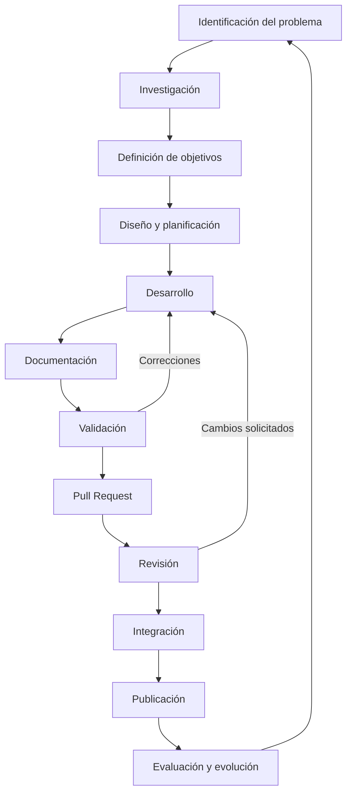
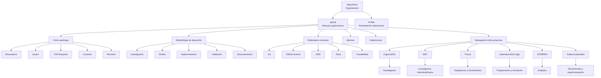

# NepoPetro

Bienvenidos a NepoPetro.

NepoPetro es un ecosistema colaborativo de investigación, desarrollo, experimentación y construcción de un portafolio técnico multidisciplinario.

Este repositorio contiene el manual transversal de la organización: criterios de participación, metodología de trabajo, convenciones, gobernanza, documentación y navegación entre proyectos.

---

## 1. ¿Qué es NepoPetro?

NepoPetro es un ecosistema de proyectos independientes que comparten principios de colaboración, investigación, documentación, trazabilidad, reproducibilidad y desarrollo abierto.

Los proyectos pueden abordar diferentes disciplinas, tecnologías, problemas y metodologías, manteniendo una estructura común que facilite su comprensión, evolución y colaboración.

El ecosistema permite integrar conocimientos de:

- Ingeniería de Sistemas.
- Arquitectura de Software.
- Arquitectura de Datos.
- Data Engineering.
- Data Governance.
- Data Stewardship.
- Analytics y Visual Analytics.
- Inteligencia Artificial.
- Matemática aplicada.
- Investigación científica.
- Automatización.
- Infraestructura.
- Seguridad.
- Educación.
- Filosofía y ciencias sociales.
- Desarrollo de software.
- Experimentación interdisciplinaria.

Cada repositorio constituye un proyecto autónomo, con sus propios objetivos, metodología, decisiones, herramientas y entregables.

---

## 2. Navegación

### Organización

- [Repositorio de proyectos](https://github.com/orgs/NepoPetro/repositories)
- [Proyectos de GitHub](https://github.com/orgs/NepoPetro/projects)
- [Discussions](https://github.com/orgs/NepoPetro/discussions)
- [Perfil institucional](./profile/README.md)

### Manual y gobernanza

Este repositorio contiene:

- Cómo participar.
- Metodología de trabajo.
- Convenciones de desarrollo.
- Estructura documental.
- Política de idiomas.
- Gobernanza.
- Trazabilidad.
- Estándares de colaboración.
- Navegación entre proyectos.

---

## 3. Proyectos

Cada proyecto tiene objetivos propios y puede encontrarse en diferentes etapas de desarrollo.

| Proyecto | Repositorio | Área |
|---|---|---|
| Cigarra3301 | [Repository](https://github.com/NepoPetro/Cigarra3301) | Investigación y experimentación |
| 30kT | [Repository](https://github.com/NepoPetro/30kT) | Investigación multidisciplinaria |
| Tmura | [Repository](https://github.com/NepoPetro/tmura) | Arquitectura, documentación y herramientas |
| LaboratorioDeC-digo | [Repository](https://github.com/NepoPetro/LaboratorioDeC-digo) | Programación y formación técnica |
| 1DFlfRMH | [Repository](https://github.com/NepoPetro/1DFlfRMH) | Analytics y visualización |
| Antiprocrastinador | [Repository](https://github.com/NepoPetro/antiprocrastinador) | Herramientas y experimentación |

La lista se actualizará conforme se incorporen nuevos proyectos al ecosistema.

---

## 4. ¿Qué no es NepoPetro?

NepoPetro no constituye una relación laboral.

La participación en la organización no implica:

- Contrato de trabajo.
- Remuneración.
- Promesa de contratación.
- Obligación de disponibilidad horaria.
- Exclusividad.
- Sustitución de empleo.
- Garantía de certificaciones.
- Garantía de resultados profesionales.

La participación es colaborativa y se fundamenta en el desarrollo de proyectos, la adquisición de experiencia, la investigación, la documentación y la construcción de un portafolio técnico verificable.

Cada participante decide su nivel de involucramiento, sujeto a las reglas de participación y reconocimiento de contribuciones establecidas en este manual.

---

## 5. ¿Por qué construir un portafolio colectivo?

El portafolio colectivo permite que los conocimientos y contribuciones individuales se integren en proyectos con mayor alcance que los que podrían desarrollarse de manera aislada.

La colaboración permite:

- Resolver problemas interdisciplinarios.
- Compartir conocimientos.
- Aprender metodologías de trabajo colaborativo.
- Practicar el desarrollo mediante Git.
- Utilizar GitHub como plataforma de gestión.
- Participar en revisiones técnicas.
- Documentar decisiones.
- Desarrollar proyectos reproducibles.
- Generar evidencia verificable de contribuciones.
- Construir experiencia técnica pública.
- Mejorar la capacidad de comunicación profesional.
- Integrar diferentes perspectivas culturales y lingüísticas.

El portafolio colectivo permite que cada participante pueda demostrar su intervención mediante evidencia técnica y documental vinculada a los proyectos.

---

## 6. Participación y reconocimiento de contribuciones

La participación en NepoPetro se fundamenta en contribuciones verificables.

La incorporación a la organización, la asistencia a reuniones o la manifestación de interés no constituyen, por sí solas, evidencia suficiente de participación activa para obtener reconocimiento de contribución.

### Evidencia de participación

La participación se demuestra mediante actividades registradas en GitHub, incluyendo:

- Participación en Discussions.
- Creación y desarrollo de Issues.
- Pull Requests.
- Commits atribuibles al participante.
- Revisión de Pull Requests.
- Documentación.
- Traducciones.
- Investigación.
- Desarrollo de código.
- Pruebas.
- Diagramas.
- Modelos matemáticos.
- Automatizaciones.
- Validaciones.
- Correcciones.
- Análisis.
- Otros entregables incorporados al proyecto mediante el flujo de colaboración.

### Criterio de participación

La participación activa para obtener reconocimiento de contribución requiere:

1. Participación en Discussions.
2. Desarrollo de contribuciones incorporadas mediante Pull Requests.
3. Commits atribuibles al participante.
4. Cumplimiento de los procedimientos de revisión del proyecto.

Las contribuciones deben ser trazables y verificables.

No se establece que todos los participantes deban contribuir de la misma manera. Las tareas pueden adaptarse a sus conocimientos, objetivos y disponibilidad.

---

## 7. Cómo incorporarse

La incorporación al ecosistema se realiza mediante participación progresiva.

### Etapa 1. Exploración

Explorar los repositorios y seleccionar aquellos proyectos que resulten de interés.

### Etapa 2. Comprensión

Leer el README, la documentación disponible, los Issues y las Discussions.

Identificar:

- Objetivos.
- Estado del proyecto.
- Metodología.
- Problemas abiertos.
- Tecnologías utilizadas.
- Áreas de colaboración.

### Etapa 3. Participación

Participar en Discussions para conocer el contexto y proponer ideas, preguntas o soluciones.

### Etapa 4. Selección de una contribución

Identificar una tarea abordable y acordar su alcance cuando corresponda.

### Etapa 5. Desarrollo

Trabajar mediante ramas y commits, respetando las convenciones del repositorio.

### Etapa 6. Pull Request

Presentar la contribución mediante un Pull Request para revisión.

### Etapa 7. Revisión y validación

Las contribuciones serán revisadas según los criterios técnicos, documentales y metodológicos correspondientes.

### Etapa 8. Integración

Una vez aprobada, la contribución podrá integrarse al proyecto.

---

## 8. Estructura de referencia

La siguiente estructura constituye una referencia transversal para los repositorios de NepoPetro.

No es una plantilla rígida. Cada proyecto puede adaptarla según su naturaleza, alcance, metodología y necesidades técnicas.

```text
repository/
│
├── README.md
├── README.pt.md
├── README.en.md
│
├── LICENSE
├── CONTRIBUTING.md
├── CODE_OF_CONDUCT.md
├── SECURITY.md
├── CITATION.cff
│
├── docs/
│   ├── architecture/
│   ├── methodology/
│   ├── specifications/
│   ├── decisions/
│   │   └── ADR/
│   ├── governance/
│   ├── research/
│   └── publications/
│
├── src/
│   └── implementation/
│
├── tests/
│   ├── unit/
│   ├── integration/
│   └── validation/
│
├── examples/
├── notebooks/
│
├── data/
│   ├── raw/
│   ├── processed/
│   └── synthetic/
│
├── models/
├── scripts/
├── diagrams/
├── assets/
├── experiments/
│
├── .github/
│   ├── ISSUE_TEMPLATE/
│   ├── PULL_REQUEST_TEMPLATE.md
│   ├── DISCUSSION_TEMPLATE/
│   └── workflows/
│       ├── tests.yml
│       ├── documentation.yml
│       ├── lint.yml
│       └── validation.yml
│
└── project-specific-directories/
````

### Consideraciones

Los elementos transversales de gobernanza y colaboración deben mantenerse en todos los proyectos.

La incorporación de directorios técnicos dependerá del proyecto.

Por ejemplo:

| Directorio          | Aplicación                                          |
| ------------------- | --------------------------------------------------- |
| src/                | Código fuente                                       |
| tests/              | Pruebas                                             |
| docs/               | Documentación                                       |
| docs/decisions/ADR/ | Registro de decisiones arquitectónicas              |
| notebooks/          | Análisis y experimentación                          |
| data/               | Gestión de datos                                    |
| models/             | Modelos matemáticos, estadísticos o computacionales |
| scripts/            | Automatización                                      |
| diagrams/           | Diagramas técnicos                                  |
| experiments/        | Experimentos reproducibles                          |
| assets/             | Recursos gráficos y multimedia                      |
| .github/workflows/  | Automatización mediante GitHub Actions              |

Los directorios pueden reorganizarse siempre que se mantenga la trazabilidad y la documentación de la estructura del proyecto.

### 9\. Convenciones de desarrollo

Todos los proyectos del ecosistema utilizan Git y GitHub como mecanismos de colaboración, control de versiones y trazabilidad.

### Elementos obligatorios

* Control de versiones mediante Git.

* Desarrollo mediante ramas cuando corresponda.

* Pull Requests.

* Commits atribuibles.

* Revisión de contribuciones.

* Issues para seguimiento de tareas y problemas.

* Discussions para intercambio y deliberación.

* GitHub Actions para automatización.

* Documentación.

* Trazabilidad de decisiones y cambios.

### GitHub Actions

Todos los proyectos deben incorporar GitHub Actions.

Los workflows se adaptarán a las características de cada proyecto y podrán incluir:

* Ejecución de pruebas.

* Validación de código.

* Linting.

* Validación de documentación.

* Comprobación de enlaces.

* Generación de artefactos.

* Automatización de publicaciones.

* Validación de datos.

* Validación de reproducibilidad.

* Construcción y despliegue.

* Integración continua.

Los workflows deben documentarse y mantenerse de acuerdo con la evolución del proyecto.

### 10\. Metodología de trabajo

Los proyectos pueden adaptar sus metodologías, manteniendo un ciclo de trabajo verificable.



El ciclo puede ser iterativo.

No todos los proyectos requieren que las etapas sean estrictamente secuenciales.

### 11\. Registro de decisiones

Las decisiones técnicas, metodológicas, arquitectónicas y organizativas relevantes deben documentarse.

Cuando corresponda, se utilizarán Architecture Decision Records (ADR).

Los ADR permiten registrar:

* Contexto.

* Problema.

* Alternativas evaluadas.

* Decisión adoptada.

* Justificación.

* Consecuencias.

* Riesgos.

* Estado de la decisión.

La documentación de decisiones facilita la comprensión histórica del proyecto y evita depender exclusivamente del conocimiento informal de sus participantes.

### 12\. Política de idiomas

Los tres idiomas oficiales de documentación y comunicación de NepoPetro son:

* Español.

* Portugués.

* Inglés.

La documentación principal de todos los proyectos debe mantenerse en los tres idiomas.

### Documentación obligatoria

Cada proyecto deberá mantener versiones equivalentes de su documentación principal.

Por ejemplo:

```text
README.md
README.pt.md
README.en.md
```

La versión adicional en otros idiomas podrá seguir una nomenclatura equivalente:

```text
README.<language-code>.md
```

### Participación lingüística

Los participantes podrán contribuir en otros idiomas.

Si una persona tiene como lengua nativa una lengua distinta del español, portugués o inglés, podrá incorporar esa lengua al proyecto y contribuir también en otros idiomas que conozca.

Sin embargo, la incorporación de idiomas adicionales no sustituye la obligación de mantener las tres lenguas oficiales.

### Traducción y revisión

La traducción, actualización y revisión de la documentación entre los tres idiomas oficiales será coordinada por administradores y reviewers.

Las contribuciones podrán incluir:

* Traducción.

* Revisión lingüística.

* Corrección terminológica.

* Adaptación técnica.

* Verificación de equivalencia conceptual.

* Actualización de documentación desfasada.

Las traducciones no deben limitarse a una sustitución literal de palabras. Deben conservar el sentido técnico, científico y metodológico del documento original.

### Objetivo

La política multilingüe permite ampliar el acceso, facilitar la colaboración internacional y construir documentación técnicamente equivalente entre diferentes comunidades lingüísticas.

### 13\. Principios transversales

Todos los proyectos de NepoPetro deben procurar mantener los siguientes principios:

### Trazabilidad

Los cambios, decisiones y contribuciones deben poder rastrearse.

### Reproducibilidad

Los procedimientos, experimentos y resultados deben documentarse de manera que puedan ser reproducidos cuando sea técnicamente posible.

### Transparencia

La metodología, limitaciones, decisiones y criterios de validación deben estar documentados.

### Colaboración

El trabajo debe permitir la participación de otras personas mediante mecanismos públicos y verificables.

### Interdisciplinariedad

Los proyectos pueden integrar diferentes disciplinas, metodologías y perspectivas.

### Documentación

La documentación constituye parte del desarrollo, no una actividad secundaria.

### Validación

Los resultados deben someterse a mecanismos de revisión y validación acordes con su naturaleza.

### Evolución

Los proyectos pueden cambiar de objetivos, metodologías, tecnologías y alcance, siempre que las decisiones relevantes sean documentadas.

### 14\. Seguridad, privacidad y ética

Los proyectos deben considerar las implicancias éticas, legales, sociales y técnicas de sus actividades.

Cuando corresponda, se deberán implementar mecanismos para:

* Proteger datos sensibles.

* Evitar la exposición de credenciales.

* Gestionar secretos.

* Respetar licencias.

* Identificar riesgos.

* Documentar limitaciones.

* Evitar la publicación de información confidencial.

* Respetar derechos de terceros.

* Identificar riesgos de uso indebido.

* Aplicar principios de minimización de datos.

* Garantizar la seguridad de las implementaciones.

Los datos privados, confidenciales o protegidos no deben incorporarse a repositorios públicos.

La documentación y las prácticas de seguridad deben adaptarse al contexto de cada proyecto.

### 15\. Licencias y propiedad intelectual

Cada proyecto debe definir una licencia apropiada para sus componentes.

La licencia deberá especificar las condiciones de uso, distribución, modificación y atribución.

Las contribuciones deben respetar:

* Licencias de terceros.

* Derechos de autor.

* Propiedad intelectual.

* Condiciones de reutilización.

* Restricciones aplicables.

* Atribución de fuentes.

Los participantes deben verificar que los materiales incorporados al proyecto puedan ser utilizados y distribuidos legalmente.

### 16\. Organización del trabajo

La gestión del trabajo puede realizarse mediante:

* Issues.

* Discussions.

* Pull Requests.

* Milestones.

* Projects.

* Wikis.

* ADR.

* Roadmaps.

* Documentación.

Cada proyecto puede adoptar herramientas adicionales de acuerdo con sus necesidades.

Las tareas deben procurar ser suficientemente claras para facilitar su comprensión, asignación, desarrollo, revisión y seguimiento.

### 17\. Perfiles de participantes

La colaboración no está limitada a un único perfil técnico.

Los proyectos pueden recibir contribuciones de personas con experiencia o interés en:

* Desarrollo.

* Ingeniería.

* Ciencia.

* Matemática.

* Análisis de datos.

* Arquitectura.

* Diseño.

* Documentación.

* Traducción.

* Educación.

* Investigación.

* Comunicación.

* Seguridad.

* Testing.

* Gestión de proyectos.

La diversidad de conocimientos permite abordar problemas desde perspectivas complementarias.

Los perfiles de los participantes pueden incorporarse a la documentación de cada proyecto cuando exista consentimiento y resulte pertinente.

### 18\. ¿Por qué NepoPetro?

NepoPetro es el nombre de la organización y de su ecosistema colaborativo.

La identidad del proyecto se construye mediante sus repositorios, contribuciones, documentación, metodologías y evolución.

El nombre constituye una identidad común que permite agrupar proyectos independientes bajo una estructura transversal de colaboración.

La historia y significado específicos del nombre podrán documentarse en esta sección cuando se incorporen formalmente al relato institucional.

### 19\. Cómo utilizar este repositorio

Este repositorio debe consultarse como manual transversal.

Antes de contribuir a un proyecto:

* Leer este README.

* Explorar el repositorio del proyecto.

* Revisar sus normas específicas.

* Consultar Issues y Discussions.

* Identificar las convenciones de desarrollo.

* Verificar los workflows.

* Consultar la documentación.

* Revisar las decisiones relevantes.

* Realizar contribuciones mediante Pull Requests.

Este manual establece criterios comunes, pero cada proyecto puede desarrollar reglas específicas adicionales.

Cuando existan diferencias, deberán estar documentadas en el repositorio correspondiente.

### 20\. Mapa de navegación del ecosistema



### Acceso directo a los proyectos

* [Cigarra3301](https://github.com/NepoPetro/Cigarra3301?utm_source=chatgpt.com)

* [30kT](https://github.com/NepoPetro/30kT?utm_source=chatgpt.com)

* [Tmura](https://github.com/NepoPetro/tmura?utm_source=chatgpt.com)

* [LaboratorioDeC-digo](https://github.com/NepoPetro/LaboratorioDeC-digo?utm_source=chatgpt.com)

* [1DFlfRMH](https://github.com/NepoPetro/1DFlfRMH?utm_source=chatgpt.com)

* [Antiprocrastinador](https://github.com/NepoPetro/antiprocrastinador?utm_source=chatgpt.com)

### 21\. Evolución del ecosistema

NepoPetro es un ecosistema en evolución.

Los repositorios pueden:

* Incorporar nuevas tecnologías.

* Cambiar metodologías.

* Ampliar sus objetivos.

* Incorporar nuevos participantes.

* Crear nuevas líneas de investigación.

* Integrar nuevos proyectos.

* Modificar sus estructuras.

* Adoptar nuevas herramientas.

* Revisar sus decisiones anteriores.

La evolución del ecosistema debe mantenerse documentada y trazable.

Las decisiones relevantes se registrarán mediante los mecanismos de documentación y colaboración correspondientes.

### 22\. Contribuir

La participación en NepoPetro implica contribuir al desarrollo y evolución de sus proyectos.

Las contribuciones se realizan mediante los mecanismos establecidos en GitHub y deben respetar las convenciones del proyecto correspondiente.

Toda contribución debe procurar:

* Ser verificable.

* Estar documentada cuando corresponda.

* Respetar las licencias.

* Mantener la trazabilidad.

* Cumplir los criterios de revisión.

* Integrarse mediante Pull Requests.

* Mantener commits atribuibles.

* Respetar la política de idiomas.

* Contribuir a la evolución colectiva del ecosistema.

La calidad del ecosistema depende tanto de los resultados técnicos como de la capacidad de documentarlos, compartirlos, revisarlos y reproducirlos.

*NepoPetro*

Research · Engineering · Collaboration · Documentation · Reproducibility
